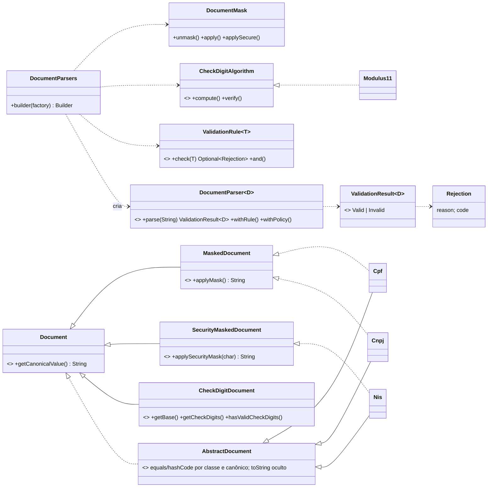

# Arquitetura do brasil4j

## Contexto

Identidade Brasileira representa CNPJ, CPF e NIS como objetos de valor imutáveis. A apresentação é validada antes de extrair o valor canônico. CNPJ e CPF oferecem modos de validação. NIS confere a estrutura do campo textual, com igualdade pelo texto canônico e saída padrão oculta. Extração de arquivos, cadastro e políticas de validade pertencem aos consumidores.

Geografia representa o código municipal do IBGE como valor estrutural e oferece a tabela de UFs. Os DDDs são dados de referência agregados. Cadastro e vigência municipal pertencem ao consumidor.

Finanças representa moedas, políticas explícitas de arredondamento, valores monetários imutáveis em hierarquia selada (`Real`, `Dolar`, `Euro` e `QuantiaMonetaria`), parcelamento/alocação proporcional sem perda de centavos e taxas de câmbio exatas e involutivas. Tabelas tributárias legais e busca de cotações online pertencem aos consumidores.

Trabalhista confere o grupo histórico da CTPS segundo o leiaute S-2200 v2.5. O perfil usa a tabela de UFs de Geografia. A extração dos campos e a declaração da origem cabem ao consumidor. A identificação da CTPS Digital segue o contrato do CPF.

## Módulos e pacotes

| Módulo | Pacote | Responsabilidade |
| --- | --- | --- |
| Reator Maven `brasil4j` | — | Coordenadas, build e verificações de documentação e cobertura. |
| `brasil4j-core` | `io.github.brasil4j.identidade` | Contratos de documento (`Document`, `MaskedDocument`, `SecurityMaskedDocument`, `CheckDigitDocument`, `AbstractDocument`), interpretação polimórfica (`DocumentParser`, `DocumentParsers`), resultado com motivo (`ValidationResult`, `Rejection`), regras componíveis (`ValidationRule`) e apresentações (`DocumentFormatter`). |
| `brasil4j-core` | `io.github.brasil4j.verificacao` | Algoritmos de dígito verificador independentes do contexto (`CheckDigitAlgorithm`, `Modulus11` configurável e presets com fonte). |
| `brasil4j-core` | `io.github.brasil4j.mascara` | Máscara declarativa de apresentação, completa e de segurança (`DocumentMask`). |
| `brasil4j-core` | `io.github.brasil4j.identidade.cnpj` | Valor CNPJ, validação numérica, alfanumérica ou de formato, e apresentação. |
| `brasil4j-core` | `io.github.brasil4j.identidade.cpf` | Valor CPF, política de formato ou DV numérico, e apresentação. |
| `brasil4j-core` | `io.github.brasil4j.identidade.nis` | Inscrição estrutural de NIS, PIS, Pasep ou NIT, com consulta de forma e composição explícita com regras e apresentações do consumidor. |
| `brasil4j-core` | `io.github.brasil4j.identidade.composicao` | Composição tipada de conferência nativa, política do consumidor e apresentação explícita (`DocumentCheck`). |
| `brasil4j-core` | `io.github.brasil4j.geografia` | Código municipal, comparação com UF e metadados das unidades federativas. |
| `brasil4j-core` | `io.github.brasil4j.financas` | Moedas, políticas de arredondamento (`ABNT_NBR_5891`, `FINANCEIRO`, `TRUNCAMENTO`, etc.), `Dinheiro` selado (`Real`, `Dolar`, `Euro`, `QuantiaMonetaria`), rateio/alocação sem perda e `TaxaCambio`. |
| `brasil4j-core` | `io.github.brasil4j.trabalhista.ctps` | Perfil histórico de CTPS, conferência estrutural e proveniência. |
| `brasil4j-kotlin` | `io.github.brasil4j.kotlin.identidade` | Value classes e extensões de documentos delegadas ao núcleo. |
| `brasil4j-kotlin` | `io.github.brasil4j.kotlin.geografia` | Value class e extensão de código municipal sobre o núcleo. |
| `brasil4j-kotlin` | `io.github.brasil4j.kotlin.financas` | Construtores fluentes e operadores aritméticos/comutativos sobre os tipos monetários do núcleo. |

## Contratos de documento (Spec 010)

Os documentos da biblioteca e os do consumidor seguem o mesmo desenho. Cada padrão resolve um problema concreto:

- **Strategy:** modos, algoritmos de DV e apresentações.
- **Decorator:** `withRule` e `withPolicy`.
- **Chain of Responsibility** com **Null Object:** `ValidationRule.and` e `accept`.
- **Builder:** `DocumentParsers`.
- **Implementação esqueleto:** `AbstractDocument`.
- **Command:** `DocumentCheck`.
- **Facade:** os utilitários `*Validator` e `*Formatter`, deprecados.

Os interpretadores seguem um pipeline fixo, em que a primeira rejeição encerra a interpretação: ausência, normalização pela máscara, regras canônicas, DV, construção do documento e regras de documento. Rejeição é resultado, não exceção. Diagnósticos produzidos pela biblioteca nunca contêm a entrada. O NIS é estrutural por padrão, e seus validadores de DV são opcionais e nomeados pela fonte ([F-15 a F-17](fontes.md)).

O núcleo depende apenas do JDK em produção. Kotlin depende dele e da biblioteca padrão Kotlin. O consumidor escolhe o artefato conforme a linguagem.

## Plataforma e entrega

Maven Wrapper, JDK 8 e 21, JaCoCo por módulo e JavaDoc com DocLint. CI confere o bytecode 52 dos JARs. Requisitos precedem código pelo Spec Kit, e os testes precedem cada regra de domínio por TDD.
