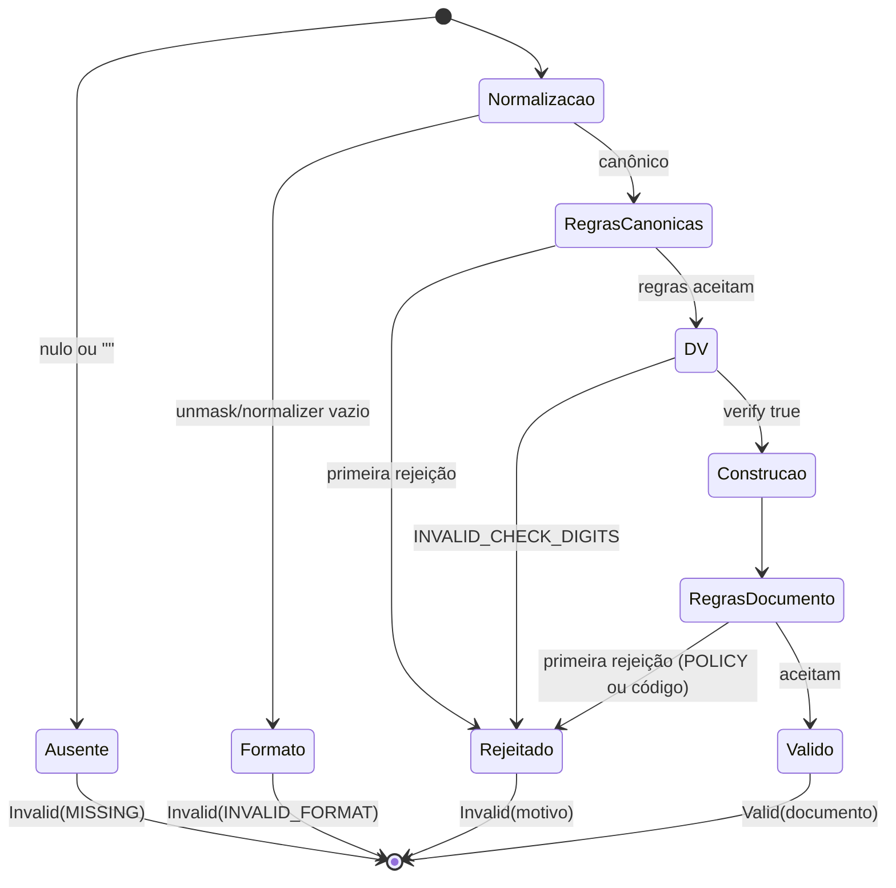

# Modelo · Spec 010

## Entidades

| Entidade | Atributos e invariantes | Relações |
| --- | --- | --- |
| `Document` | Valor canônico não nulo e imutável. | Contrato raiz |
| `MaskedDocument` | Apresentação mascarada derivada do canônico. | Estende `Document` (CPF, CNPJ) |
| `CheckDigitDocument` | Base, DVs informados e `hasValidCheckDigits()`, que não depende do modo usado na construção. | Estende `Document` (CPF, CNPJ) |
| `AbstractDocument` | Igualdade por classe concreta e canônico; `hashCode` pelo canônico; `toString` oculto por padrão. | Superclasse de `Cpf`, `Cnpj`, `Nis` e de documentos do consumidor |
| `Rejection` | Motivo obrigatório e código simbólico opcional, não vazio. Não contém entrada, canônico nem saída. | Produzida por regras e interpretadores |
| `ValidationResult<D>` | Exatamente um estado. `Valid` tem documento não nulo; `Invalid` tem rejeição não nula. | Saída de `DocumentParser` |
| `ValidationRule<T>` | Função pura que, para um valor, devolve uma rejeição ou nada. | Compõe-se por `and` |
| `DocumentParser<D>` | Nunca lança exceção para entrada inválida. É sem estado e reutilizável. | Construído por `DocumentParsers.Builder` ou implementado pelo consumidor |
| `CheckDigitAlgorithm` | `digitCount ≥ 1`. `compute` é determinístico e rejeita nulo, comprimento ou domínio inválidos. | Usado pelo builder e por regras |
| `DocumentMask` | Padrão com pelo menos um slot. O comprimento canônico é o número de slots. | Usado pelo builder e pelos documentos mascarados |

## Pipeline do interpretador construído pelo builder

Cada etapa roda no máximo uma vez por interpretação. Regras decoradas por `withRule`/`withPolicy` rodam depois das regras do builder, na ordem em que foram acrescentadas.

## Configurações nativas

| Documento | Normalização | Regras canônicas | DV | Mensagem |
| --- | --- | --- | --- | --- |
| CPF `FORMAT_ONLY` | `999.999.999-99` | — | — | "CPF inválido." |
| CPF `NUMERIC` | idem | — | `Modulus11.cpf()` | idem |
| CNPJ `FORMAT_ONLY` | `XX.XXX.XXX/XXXX-99` | — | — | "CNPJ inválido." |
| CNPJ `ALPHANUMERIC` | idem | 14 zeros → `INVALID_CHECK_DIGITS` | `Modulus11.cnpj()` | idem |
| CNPJ `NUMERIC` | idem | base não numérica → `UNSUPPORTED_BASE`; 14 zeros | `Modulus11.cnpj()` | idem |
| NIS `FORMAT_ONLY` | 11 dígitos ASCII literais, sem máscara | — | — | "NIS inválido." |
| NIS `CAIXA_FGTS_V016` | idem | — | `Modulus11.pisCaixaFgtsV016()` | idem |
| NIS `LEGACY_MOD11` | idem | — | `Modulus11.pisLegacyMod11()`, depois a regra de documento `NisRules.repeatedDigits()` | idem |

A ordem das regras preserva o comportamento atual. No CNPJ `NUMERIC`, a base é conferida antes do DV. No NIS, a guarda pode ser encadeada a qualquer modo por `withRule(NisRules.repeatedDigits())`.

## `DocumentCheck`

| Desfecho do interpretador | Política do item | Status | Saída |
| --- | --- | --- | --- |
| `Invalid` com motivo diferente de `POLICY` | não roda | `REJECTED_BY_VALIDATION` | vazia |
| `Invalid` com `POLICY` | não roda | `REJECTED_BY_POLICY` | vazia |
| `Valid` | `false` | `REJECTED_BY_POLICY` | vazia |
| `Valid` | `true` ou ausente | `ACCEPTED` | formatador, se configurado |
